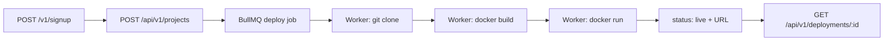

# Fleet

Fleet is a self-hosted PaaS built as a Bun monorepo. Connect a GitHub repo, push to a branch, and Fleet clones the code, builds a Docker image, runs the container behind Traefik, and gives you a stable URL — auto-redeploying on every push.

See [`TODO.md`](TODO.md) for the prioritized product backlog, including the
remote MCP interface for agent-driven deployments. Production readiness and
maintenance expectations are defined in
[`docs/OPERATIONS.md`](docs/OPERATIONS.md).

**What's real today:** GitHub OAuth login (profile/email only), a separate GitHub App connection for selected repositories with read-only code access, webhook-driven auto-deploy on push, a working dashboard (project CRUD, live SSE deployment logs, encrypted env var management, connections page), blue/green container cutover with no downtime on redeploy, and per-plan compute sandboxing.

**What's not built yet:** a remote agent for running deploys on a server other than the one running the worker (`apps/agent` — types only), a CLI (`apps/cli` — deps only), and deployment rollback. Custom domains are built (via Cloudflare for SaaS — see below), pending a one-time Cloudflare zone setup the operator has to do outside this repo. See [`docs/architecture.md`](docs/architecture.md#roadmap--not-yet-implemented) for the full gap list and [`docs/CONTEXT.md`](docs/CONTEXT.md) for the current planning/decision log on where this is headed next.

## How it works



1. User signs up and receives a JWT.
2. User creates a **Project** (name + repo URL). The API writes metadata to MongoDB and enqueues one deploy job.
3. The **worker** picks up the job from Redis (BullMQ) and runs the pipeline:
   - Clone repo to `/tmp/fleet-builds/{deploymentId}`
   - `docker build` → tag `fleet/{projectId}:{deploymentId}`
   - Start container on Traefik with hostname `depl-fleet-{projectId}.localhost`
4. Deployment status is updated in MongoDB at each step. Poll the API to get status, image tag, and URL.
5. Open the returned `url` (e.g. `http://depl-fleet-{projectId}.localhost:18080`) to reach the running app.

Each project gets a deterministic **subdomain** of `depl-fleet-{projectId}`. Traefik routes by `Host` header on port **18080** — no random host ports.

## Monorepo layout

| Path | Role | Status |
|------|------|--------|
| [`apps/api`](apps/api) | Express REST API — auth, projects, deployments | **Active** |
| [`apps/worker`](apps/worker) | BullMQ worker — clone, build, run | **Active** |
| [`apps/dashboard`](apps/dashboard) | Next.js UI — auth, projects, live deploy logs, env vars, GitHub connections | **Active** |
| [`apps/agent`](apps/agent) | Remote server agent (WebSocket + Docker) | Planned (deps only) |
| [`apps/cli`](apps/cli) | CLI tool | Planned (deps only) |
| [`packages/db`](packages/db) | Mongoose models — User, Project, Environment, Server, Deployment | **Active** |
| [`packages/queue`](packages/queue) | BullMQ queue + Redis connection | **Active** |
| [`packages/config`](packages/config) | Validated env (`getEnv`, `getSharedEnv`) | **Active** |
| [`packages/auth`](packages/auth) | JWT sign/verify + Express middleware | **Active** |
| [`packages/api-middleware`](packages/api-middleware) | Request validation, error handling | **Active** |
| [`packages/errors`](packages/errors) | `AppError`, error response helpers | **Active** |
| [`packages/types`](packages/types) | Shared TypeScript types and enums | **Active** |
| [`packages/runtime-detector`](packages/runtime-detector) | Detect `Dockerfile` at repo root | **Active** (auto-generate Dockerfile planned) |

## Prerequisites

- [Bun](https://bun.sh) v1.3+
- Docker Desktop or Docker Engine (daemon running; worker uses the local socket via dockerode)
- MongoDB (Atlas or local) — connection string in root `.env`
- Redis — provided by `docker compose` in this repo

## Quick start

### 1. Environment

All secrets live in a **single root `.env`** (not per-app). Copy the template and fill in values:

```bash
cp .env.example .env
```

If you previously had `apps/api/.env`, merge once:

```bash
bun run migrate:env
```

The worker uses shared variables (`MONGODB_URI`, `REDIS_URL`, and Traefik routing vars). The API additionally requires `JWT_SECRET`, `GITHUB_WEBHOOK_SECRET`, and `AGENT_TOKEN`.

### 2. Install and infrastructure

```bash
bun install
docker compose up -d   # Redis on localhost:16379, Traefik on :18080
```

### 3. Run API and worker

In separate terminals:

```bash
bun run dev:api
bun run dev:worker
```

API listens on port **3010** by default (`PORT` in `.env`).

### 4. Deploy a test repo

Use a repo with **`Dockerfile` or `dockerfile` at the repository root**. After clone, the worker checks for this file before building; missing Dockerfile fails with a clear error (not an opaque Docker build failure). The worker auto-detects the exposed port from the built image (the test repo uses **3001**):

**Test repo:** [github.com/mondeep31/fleet-test-repo-1](https://github.com/mondeep31/fleet-test-repo-1)

```bash
# Sign up
curl -s -X POST http://localhost:3010/v1/signup \
  -H 'Content-Type: application/json' \
  -d '{"name":"Dev User","email":"you@example.com","password":"password123"}'

# Save the token from the response, then create a project (auto-starts deploy)
curl -s -X POST http://localhost:3010/api/v1/projects \
  -H 'Content-Type: application/json' \
  -H "Authorization: Bearer YOUR_TOKEN" \
  -d '{"name":"my-app","repoUrl":"https://github.com/mondeep31/fleet-test-repo-1.git"}'

# Poll deployment (use deploymentId from project response)
curl -s http://localhost:3010/api/v1/deployments/DEPLOYMENT_ID \
  -H "Authorization: Bearer YOUR_TOKEN"

# When status is "live", open or curl the url field (depl-fleet-{projectId}.localhost:18080)
curl -s http://depl-fleet-PROJECT_ID.localhost:18080
# → {"message":"Hello World"}
```

## Environment variables

| Variable | Required by | Description |
|----------|-------------|-------------|
| `MONGODB_URI` | API, worker | MongoDB connection string |
| `REDIS_URL` | API, worker | Redis URL (default `redis://localhost:16379`) |
| `NODE_ENV` | API, worker | `development` \| `production` \| `test` |
| `JWT_SECRET` | API | Min 32 characters |
| `GITHUB_WEBHOOK_SECRET` | API | HMAC secret for GitHub push deliveries. Generate: `openssl rand -hex 32` |
| `AGENT_TOKEN` | API | Placeholder until agent is implemented |
| `PORT` | API | HTTP port (default `3010`) |
| `API_URL` | API | Public API URL (default `http://localhost:3010`). Configure the GitHub App webhook at `{API_URL}/webhooks/github` |
| `GITHUB_APP_CLIENT_ID`, `GITHUB_APP_CLIENT_SECRET` | API, worker | Repository GitHub App credentials, used for authorization and refreshing deployment tokens |
| `GITHUB_APP_SLUG`, `GITHUB_APP_CALLBACK_URL` | API | App installation slug and authorization callback; see [GitHub setup](docs/GITHUB_SETUP.md) |
| `GITHUB_LOGIN_CLIENT_ID`, `GITHUB_LOGIN_CLIENT_SECRET`, `GITHUB_LOGIN_CALLBACK_URL` | API | Separate OAuth App for profile/email sign-in |
| `GITHUB_OAUTH_SUCCESS_REDIRECT` | API | Dashboard URL to return to after connecting repositories |
| `FLEET_APPS_DOMAIN` | API, worker | App hostname suffix (default `localhost`; use `mondeep.xyz` or your apex domain in production) |
| `FLEET_PUBLIC_URL_SCHEME` | API, worker | `http` or `https` (default `http`) |
| `FLEET_TRAEFIK_PUBLIC_PORT` | API, worker | Public Traefik port in URLs (default `18080`; leave empty for HTTPS on 443) |
| `FLEET_TRAEFIK_NETWORK` | Worker | Docker network Traefik shares with app containers (default `fleet-proxy`) |

Validated at startup via [`@fleet/config`](packages/config/env.ts). Invalid env causes the process to exit with a clear error.

## API reference

### GitHub push webhooks (auto-deploy)

New connections use a GitHub App configured with read-only Contents access and
an app-level Push webhook; Fleet does not manage repository hooks for these
connections. On every `git push` to the tracked branch, GitHub delivers a
`POST /webhooks/github` to the API, which verifies the signature, matches active
projects, and enqueues deployments. Legacy OAuth connections retain their
per-repository hooks during migration.

Create the repository GitHub App and configure its credentials using
[GitHub setup and migration](docs/GITHUB_SETUP.md).

**Requirements:**
- `API_URL` must be a publicly reachable HTTPS URL in production (Fleet uses `{API_URL}/webhooks/github` as the webhook delivery URL). When the dashboard and API share a host (e.g. `https://fleet.mondeep.xyz`), the dashboard rewrites `/webhooks/*` to the API on port 3010.
- `GITHUB_WEBHOOK_SECRET` must match the GitHub App webhook secret.
- Users connect the repository GitHub App from Connections and select the repositories to deploy. Status returns `fineGrained: true` for App connections and `needsReconnect: true` for legacy OAuth connections.
- **Cloudflare:** if webhook deliveries show error 1000 ("DNS points to prohibited IP"), the DNS A record origin must be a public IP — not `127.0.0.1` or a LAN address. Use Cloudflare Tunnel if the host is behind NAT.

**Local dev:** GitHub cannot reach `localhost`. Use [ngrok](https://ngrok.com) or [Cloudflare Tunnel](https://developers.cloudflare.com/cloudflare-one/connections/connect-networks/) to expose the API, then set `API_URL` to the tunnel URL and restart the API.

### Public (no auth)

| Method | Path | Description |
|--------|------|-------------|
| `GET` | `/health` | Health check |
| `GET` | `/ping` | Ping |
| `POST` | `/v1/signup` | Create account → JWT |
| `POST` | `/v1/login` | Login → JWT |
| `POST` | `/webhooks/github` | GitHub push webhook receiver (HMAC-verified) |

### Authenticated (`Authorization: Bearer <token>`)

| Method | Path | Description |
|--------|------|-------------|
| `GET` | `/api/v1/users/:id` | Get user |
| `PATCH` | `/api/v1/users/` | Update password |
| `POST` | `/api/v1/projects` | Create project + queue deploy |
| `GET` | `/api/v1/projects` | List projects |
| `GET` | `/api/v1/deployments/:deploymentId` | Full deployment record |
| `GET` | `/api/v1/deployments/:deploymentId/status` | Status, url, error only |
| `GET` | `/api/v1/deployments/project/:projectId` | All deployments for a project |
| `GET` | `/api/v1/deployments/:deploymentId/logs/stream` | SSE log stream (build via Redis, runtime via Docker tail) |
| `GET` | `/api/v1/deployments/:deploymentId/logs` | Deprecated (410) — use `/logs/stream` |
| `DELETE` | `/api/v1/deployments/:deploymentId` | Stop/cancel deployment (removes container, cancels queued jobs) |
| `GET`/`PUT` | `/api/v1/projects/:projectId/variables` | Read/write encrypted env vars for a project (saving triggers a redeploy) |
| `GET` | `/api/v1/integrations/github/connect` | Start repository GitHub App installation (separate from login) |
| `GET` | `/api/v1/integrations/github/setup` | Installation setup redirect to user authorization |
| `GET`/`DELETE` | `/api/v1/integrations/github` | Connection status (incl. `needsReconnect`) / disconnect |
| `GET` | `/api/v1/integrations/github/repos` | List repos for the connected GitHub account |
| `GET` | `/api/v1/integrations/github/repos/:owner/:repo/branches` | List branches for a repo |
| `POST` | `/api/v1/integrations/github/repos/validate` | Check a repo/branch for a root Dockerfile before creating a project |

## Deployment lifecycle

| Status | Meaning |
|--------|---------|
| `queued` | Job enqueued in BullMQ, waiting for worker |
| `cloning` | Worker is cloning the Git repo |
| `cloned` | Repo on disk; commit SHA saved |
| `building` | `docker build` in progress |
| `deploying` | Starting container |
| `live` | Container running; `url` set |
| `failed` | Pipeline error; see `error` field |
| `stopped` | Stopped or cancelled via `DELETE`; container removed, `url` cleared |
| `rolled_back` | Reserved for rollback (not implemented) |

Happy path: `queued` → `cloning` → `cloned` → (Dockerfile detect) → `building` → `deploying` → `live`.

`DELETE /deployments/:id` works for **live**, **failed**, and **queued** deployments. Queued jobs are removed from BullMQ; in-flight jobs are cooperatively cancelled when the worker checks status between steps.

## Local dev conventions

| Resource | Pattern |
|----------|---------|
| Clone directory | `/tmp/fleet-builds/{deploymentId}` |
| Docker image tag | `fleet/{projectId}:{deploymentId}` |
| Container name | `fleet-project-{projectId}` |
| URL format | `http://depl-fleet-{projectId}.localhost:18080` (local) |
| Traefik network | `fleet-proxy` |

Build and pipeline output is published to a **Redis Stream** (`logs:{deploymentId}`) by the worker during deploy, with a **24h TTL**. Live app output is tailed from Docker via `docker logs -f`. The dashboard consumes both through **`GET /deployments/:id/logs/stream`** (SSE). Logs are not stored in MongoDB.

### Stop a deployment

```bash
curl -s -X DELETE http://localhost:3010/api/v1/deployments/DEPLOYMENT_ID \
  -H "Authorization: Bearer YOUR_TOKEN"
```

### Optional manual cleanup

```bash
# Remove built image (optional)
docker rmi fleet/PROJECT_ID:DEPLOYMENT_ID

# Remove clone directory (optional)
rm -rf /tmp/fleet-builds/DEPLOYMENT_ID
```

## Scripts

| Command | Description |
|---------|-------------|
| `bun run dev:api` | API with watch mode |
| `bun run dev:worker` | Worker with watch mode |
| `bun run dev:dashboard` | Next.js dashboard (scaffold) |
| `bun run dev:agent` | Agent (not implemented) |
| `bun run dev:cli` | CLI (not implemented) |
| `bun test` | Run Vitest suite |
| `bun run migrate:env` | Merge legacy `apps/api/.env` into root `.env` |
| `bun run setup:hooks` | Install git hooks |

## Roadmap

### Phase 1 — Operability

| Task | Notes |
|------|-------|
| ~~Stop deployment~~ | Done — `DELETE /deployments/:id` stops live, cancels queued, cooperative cancel in-flight |
| ~~Build log streaming~~ | Done — SSE via Redis Streams (24h) + Docker runtime tail |
| ~~Dockerfile detector~~ | Done — root `Dockerfile` / `dockerfile` check before build |
| **Redeploy** | New production deployment for same project without recreating it |

### Phase 2 — Routing and polish

| Task | Notes |
|------|-------|
| ~~Traefik integration~~ | Done — subdomain routing via Traefik on `fleet-proxy` network |
| **Environment model** | Use `Environment` (branch) instead of MVP placeholders (`main`, `default`) |
| **Preview deployments** | Per-branch/PR preview: another `Deployment` + queue job (same pipeline as prod), unique preview URL (e.g. `pr-42.{project}.localhost` via Traefik). Ephemeral — stop/delete when done or when PR closes |

### Phase 3 — Platform expansion

| Task | Notes |
|------|-------|
| ~~GitHub integration~~ | Done — minimal OAuth login + repository GitHub App, selected repo/branch picker, webhook auto-deploy on push |
| ~~Dashboard~~ | Done — auth, project CRUD, live SSE deploy logs, env var management, connections page |
| **Registry push** | Push images to GHCR before run (needed for remote servers) |
| **Agent** | WebSocket agent on managed/user-owned servers ([`packages/types/src/agent.ts`](packages/types/src/agent.ts)); `Server` model already exists but is unused — see [`docs/CONTEXT.md`](docs/CONTEXT.md) |
| **Runtime detector improvements** | Dockerfile in subdirectories; generate a Dockerfile when repo has none beyond the current Railpack fallback |

### Phase 4 — Public showcase readiness

| Task | Notes |
|------|-------|
| ~~Custom domains~~ | Done in-app, via Cloudflare for SaaS (not self-issued ACME — the box is tunnel-only, no public inbound port for Let's Encrypt to reach). `Domain` model, background verification sweep, Traefik dynamic routing, and dashboard UI all built. One-time Cloudflare zone/tunnel setup still required outside this repo — checklist in [`docs/CONTEXT.md`](docs/CONTEXT.md) |
| **Deployment rollback** | `rolled_back` status is defined but no code path ever sets it |
| **Health checks** | "Live" currently only means "container reported Running"; no HTTP-level check |
| **Build isolation hardening** | All user Dockerfiles currently build/run on one shared Docker daemon; sandboxing exists (`CapDrop`, resource limits) but isn't full isolation |

### Custom domains — investigated, not pursued

- **Skip the ownership TXT by deferring hostname creation.** Idea: defer calling
  Cloudflare's `createCustomHostname` until our own DNS check confirms the routing
  CNAME already resolves, so Cloudflare treats ownership as pre-proven and skips the
  TXT challenge. Prototyped and tested against a live domain (2026-07-27) — abandoned.
  Root cause: it only works when the customer's routing CNAME is DNS-only. If the
  customer's own domain is *also* on Cloudflare and that record is proxied (orange
  cloud), the real CNAME target is invisible to any public resolver, including the
  ones a server-side precheck would use — Cloudflare hides it behind its own edge
  IPs. This isn't fixable by picking a different resolver: Cloudflare's own
  ownership-verification check almost certainly hits the same wall for a
  cross-account zone it has no API access into, so routing the check through
  Cloudflare's API instead of our own doesn't help either. Since a meaningful chunk
  of real users run their domain's DNS through Cloudflare with proxying on by
  default, this isn't a rare edge case — full writeup in
  [`docs/CONTEXT.md`](docs/CONTEXT.md). The existing immediate-hostname-creation flow
  (always shows the ownership TXT) remains the shipped behavior.

## Architecture decisions

- **Bun monorepo** — workspaces for apps and shared packages; fast installs and native TypeScript.
- **BullMQ + Redis** — deploys are async and durable; API returns immediately after enqueue.
- **dockerode in worker** — build and run happen on the machine running the worker (local dev today; agent later for remote).
- **Single root `.env`** — `@fleet/config` validates once; API uses `getEnv()`, worker/db/queue use `getSharedEnv()`.
- **Managed servers (future)** — production target is Fleet-managed hosts via the agent, not the developer's laptop.
- **Traefik** — stable deploy URLs (`depl-fleet-{projectId}.localhost:18080` locally; `https://depl-fleet-{projectId}.yourdomain.com` in production).

## Public HTTPS for deploy URLs (Phase 2)

Deploy URLs use the pattern `https://depl-fleet-{projectId}.mondeep.xyz` (replace `mondeep.xyz` with your domain). Fleet dashboard stays on a separate host (e.g. `fleet.mondeep.xyz`).

1. Update server `.env`:

```bash
FLEET_APPS_DOMAIN=mondeep.xyz
FLEET_PUBLIC_URL_SCHEME=https
FLEET_TRAEFIK_PUBLIC_PORT=
```

2. Add DNS: `A` record `*` → server IP (wildcard for deploy subdomains).
3. Issue a wildcard TLS cert and configure nginx to proxy `depl-fleet-*.mondeep.xyz` → `http://127.0.0.1:18080` (Traefik).
4. **Redeploy** existing projects so Traefik labels and stored URLs use the new domain.

Full server setup steps: [`docs/production-deploy-urls.md`](docs/production-deploy-urls.md).

Optional later: Cloudflare Tunnel instead of opening port 443 — route `*.mondeep.xyz` → Traefik; TLS terminates at Cloudflare.

## Docker Compose services

| Service | Port | Purpose |
|---------|------|---------|
| `redis` | `16379` | BullMQ job queue |
| `traefik` | `18080` (web), `18081` (dashboard) | Reverse proxy — routes deploys by subdomain |

## Contributing / internal notes

Scratch notes and early planning live in [`docs/README.md`](docs/README.md). For day-to-day development, this file is the canonical reference.
