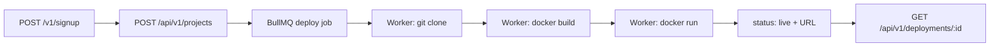

# Fleet

Fleet is a self-hosted PaaS built as a Bun monorepo. Connect a Git repository, trigger a deployment, and Fleet clones the code, builds a Docker image, runs the container, and gives you a URL to hit.

The current milestone is a **local end-to-end deploy pipeline** — no dashboard, no GitHub OAuth, no remote agent yet. The goal is proven: API call → repo cloned → image built → container running → `curl` the app.

## How it works



1. User signs up and receives a JWT.
2. User creates a **Project** (name + repo URL). The API writes metadata to MongoDB and enqueues one deploy job.
3. The **worker** picks up the job from Redis (BullMQ) and runs the pipeline:
   - Clone repo to `/tmp/fleet-builds/{deploymentId}`
   - `docker build` → tag `fleet/{projectId}:{deploymentId}`
   - `docker run` with a random host port mapped to the image's exposed port
4. Deployment status is updated in MongoDB at each step. Poll the API to get status, image tag, and URL.
5. `curl` the returned `url` (e.g. `http://localhost:55004`) to reach the running app.

Containers are named `fleet-{deploymentId}` so you can identify them locally. Routing today uses random `localhost` ports — Traefik is in `docker-compose.yml` but not wired into deploys yet.

## Monorepo layout

| Path | Role | Status |
|------|------|--------|
| [`apps/api`](apps/api) | Express REST API — auth, projects, deployments | **Active** |
| [`apps/worker`](apps/worker) | BullMQ worker — clone, build, run | **Active** |
| [`apps/dashboard`](apps/dashboard) | Next.js UI | Scaffold (boilerplate) |
| [`apps/agent`](apps/agent) | Remote server agent (WebSocket + Docker) | Planned (deps only) |
| [`apps/cli`](apps/cli) | CLI tool | Planned (deps only) |
| [`packages/db`](packages/db) | Mongoose models — User, Project, Environment, Server, Deployment | **Active** |
| [`packages/queue`](packages/queue) | BullMQ queue + Redis connection | **Active** |
| [`packages/config`](packages/config) | Validated env (`getEnv`, `getSharedEnv`) | **Active** |
| [`packages/auth`](packages/auth) | JWT sign/verify + Express middleware | **Active** |
| [`packages/api-middleware`](packages/api-middleware) | Request validation, error handling | **Active** |
| [`packages/errors`](packages/errors) | `AppError`, error response helpers | **Active** |
| [`packages/types`](packages/types) | Shared TypeScript types and enums | **Active** |
| [`packages/runtime-detector`](packages/runtime-detector) | Detect `Dockerfile` at repo root | **Active** (auto-generate Dockerfile planned) |

## Prerequisites

- [Bun](https://bun.sh) v1.3+
- Docker Desktop or Docker Engine (daemon running; worker uses the local socket via dockerode)
- MongoDB (Atlas or local) — connection string in root `.env`
- Redis — provided by `docker compose` in this repo

## Quick start

### 1. Environment

All secrets live in a **single root `.env`** (not per-app). Copy the template and fill in values:

```bash
cp .env.example .env
```

If you previously had `apps/api/.env`, merge once:

```bash
bun run migrate:env
```

The worker only needs shared variables (`MONGODB_URI`, `REDIS_URL`). The API additionally requires `JWT_SECRET`, `GITHUB_WEBHOOK_SECRET`, and `AGENT_TOKEN`.

### 2. Install and infrastructure

```bash
bun install
docker compose up -d   # Redis on localhost:16379, Traefik on :18080 (not used by deploys yet)
```

### 3. Run API and worker

In separate terminals:

```bash
bun run dev:api
bun run dev:worker
```

API listens on port **3010** by default (`PORT` in `.env`).

### 4. Deploy a test repo

Use a repo with **`Dockerfile` or `dockerfile` at the repository root**. After clone, the worker checks for this file before building; missing Dockerfile fails with a clear error (not an opaque Docker build failure). The worker auto-detects the exposed port from the built image (the test repo uses **3001**):

**Test repo:** [github.com/mondeep31/fleet-test-repo-1](https://github.com/mondeep31/fleet-test-repo-1)

```bash
# Sign up
curl -s -X POST http://localhost:3010/v1/signup \
  -H 'Content-Type: application/json' \
  -d '{"name":"Dev User","email":"you@example.com","password":"password123"}'

# Save the token from the response, then create a project (auto-starts deploy)
curl -s -X POST http://localhost:3010/api/v1/projects \
  -H 'Content-Type: application/json' \
  -H "Authorization: Bearer YOUR_TOKEN" \
  -d '{"name":"my-app","repoUrl":"https://github.com/mondeep31/fleet-test-repo-1.git"}'

# Poll deployment (use deploymentId from project response)
curl -s http://localhost:3010/api/v1/deployments/DEPLOYMENT_ID \
  -H "Authorization: Bearer YOUR_TOKEN"

# When status is "live", curl the url field
curl -s http://localhost:ASSIGNED_PORT
# → {"message":"Hello World"}
```

## Environment variables

| Variable | Required by | Description |
|----------|-------------|-------------|
| `MONGODB_URI` | API, worker | MongoDB connection string |
| `REDIS_URL` | API, worker | Redis URL (default `redis://localhost:16379`) |
| `NODE_ENV` | API, worker | `development` \| `production` \| `test` |
| `JWT_SECRET` | API | Min 32 characters |
| `GITHUB_WEBHOOK_SECRET` | API | Placeholder until GitHub webhooks are implemented |
| `AGENT_TOKEN` | API | Placeholder until agent is implemented |
| `PORT` | API | HTTP port (default `3010`) |
| `API_URL` | API | Public API URL (default `http://localhost:3010`) |

Validated at startup via [`@fleet/config`](packages/config/env.ts). Invalid env causes the process to exit with a clear error.

## API reference

### Public (no auth)

| Method | Path | Description |
|--------|------|-------------|
| `GET` | `/health` | Health check |
| `GET` | `/ping` | Ping |
| `POST` | `/v1/signup` | Create account → JWT |
| `POST` | `/v1/login` | Login → JWT |

### Authenticated (`Authorization: Bearer <token>`)

| Method | Path | Description |
|--------|------|-------------|
| `GET` | `/api/v1/users/:id` | Get user |
| `PATCH` | `/api/v1/users/` | Update password |
| `POST` | `/api/v1/projects` | Create project + queue deploy |
| `GET` | `/api/v1/projects` | List projects |
| `GET` | `/api/v1/deployments/:deploymentId` | Full deployment record |
| `GET` | `/api/v1/deployments/:deploymentId/status` | Status, url, error only |
| `GET` | `/api/v1/deployments/project/:projectId` | All deployments for a project |
| `GET` | `/api/v1/deployments/:deploymentId/logs` | Build + pipeline logs from DB |
| `DELETE` | `/api/v1/deployments/:deploymentId` | Stop/cancel deployment (removes container, cancels queued jobs) |

## Deployment lifecycle

| Status | Meaning |
|--------|---------|
| `queued` | Job enqueued in BullMQ, waiting for worker |
| `cloning` | Worker is cloning the Git repo |
| `cloned` | Repo on disk; commit SHA saved |
| `building` | `docker build` in progress |
| `deploying` | Starting container |
| `live` | Container running; `url` set |
| `failed` | Pipeline error; see `error` field |
| `stopped` | Stopped or cancelled via `DELETE`; container removed, `url` cleared |
| `rolled_back` | Reserved for rollback (not implemented) |

Happy path: `queued` → `cloning` → `cloned` → (Dockerfile detect) → `building` → `deploying` → `live`.

`DELETE /deployments/:id` works for **live**, **failed**, and **queued** deployments. Queued jobs are removed from BullMQ; in-flight jobs are cooperatively cancelled when the worker checks status between steps.

## Local dev conventions

| Resource | Pattern |
|----------|---------|
| Clone directory | `/tmp/fleet-builds/{deploymentId}` |
| Docker image tag | `fleet/{projectId}:{deploymentId}` |
| Container name | `fleet-{deploymentId}` |
| URL format | `http://localhost:{randomHostPort}` |

Build output and pipeline milestones are appended to `Deployment.logs[]` in MongoDB. Fetch via `GET /deployments/:id/logs`. Real-time log streaming (SSE/WebSocket) is planned — today you poll the full log array.

### Stop a deployment

```bash
curl -s -X DELETE http://localhost:3010/api/v1/deployments/DEPLOYMENT_ID \
  -H "Authorization: Bearer YOUR_TOKEN"
```

### Optional manual cleanup

```bash
# Remove built image (optional)
docker rmi fleet/PROJECT_ID:DEPLOYMENT_ID

# Remove clone directory (optional)
rm -rf /tmp/fleet-builds/DEPLOYMENT_ID
```

## Scripts

| Command | Description |
|---------|-------------|
| `bun run dev:api` | API with watch mode |
| `bun run dev:worker` | Worker with watch mode |
| `bun run dev:dashboard` | Next.js dashboard (scaffold) |
| `bun run dev:agent` | Agent (not implemented) |
| `bun run dev:cli` | CLI (not implemented) |
| `bun test` | Run Vitest suite |
| `bun run migrate:env` | Merge legacy `apps/api/.env` into root `.env` |
| `bun run setup:hooks` | Install git hooks |

## Roadmap

### Phase 1 — Operability

| Task | Notes |
|------|-------|
| ~~Stop deployment~~ | Done — `DELETE /deployments/:id` stops live, cancels queued, cooperative cancel in-flight |
| ~~Build logs in DB~~ | Done — `GET /deployments/:id/logs`; streaming (SSE/WebSocket) planned |
| ~~Dockerfile detector~~ | Done — root `Dockerfile` / `dockerfile` check before build |
| **Redeploy** | New production deployment for same project without recreating it |

### Phase 2 — Routing and polish

| Task | Notes |
|------|-------|
| **Traefik integration** | Label containers for subdomain routing via existing Traefik service |
| **Environment model** | Use `Environment` (branch, subdomain) instead of MVP placeholders (`main`, `default`) |
| **Preview deployments** | Per-branch/PR preview: another `Deployment` + queue job (same pipeline as prod), unique preview URL (e.g. `pr-42.{project}.localhost` via Traefik). Ephemeral — stop/delete when done or when PR closes |

### Phase 3 — Platform expansion

| Task | Notes |
|------|-------|
| **Runtime detector** | Detect stack; generate Dockerfile when repo has none |
| **Registry push** | Push images to GHCR before run (needed for remote servers) |
| **Agent** | WebSocket agent on managed servers ([`packages/types/src/agent.ts`](packages/types/src/agent.ts)) |
| **GitHub integration** | Webhooks, OAuth, auto-deploy on push |
| **Dashboard** | Projects, deployments, logs UI |

## Architecture decisions

- **Bun monorepo** — workspaces for apps and shared packages; fast installs and native TypeScript.
- **BullMQ + Redis** — deploys are async and durable; API returns immediately after enqueue.
- **dockerode in worker** — build and run happen on the machine running the worker (local dev today; agent later for remote).
- **Single root `.env`** — `@fleet/config` validates once; API uses `getEnv()`, worker/db/queue use `getSharedEnv()`.
- **Managed servers (future)** — production target is Fleet-managed hosts via the agent, not the developer's laptop.
- **Traefik (future)** — subdomain routing instead of raw `localhost` ports.

## Docker Compose services

| Service | Port | Purpose |
|---------|------|---------|
| `redis` | `16379` | BullMQ job queue |
| `traefik` | `18080` (web), `18081` (dashboard) | Reverse proxy — present but not used by deploy pipeline yet |

## Contributing / internal notes

Scratch notes and early planning live in [`docs/README.md`](docs/README.md). For day-to-day development, this file is the canonical reference.
