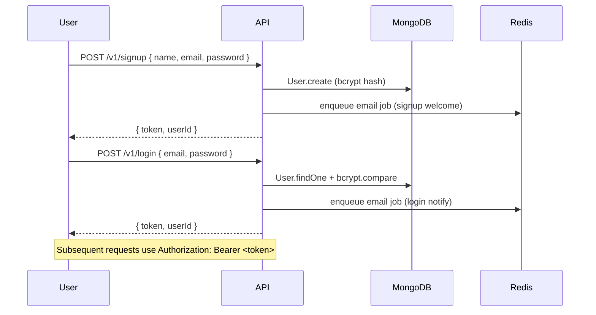
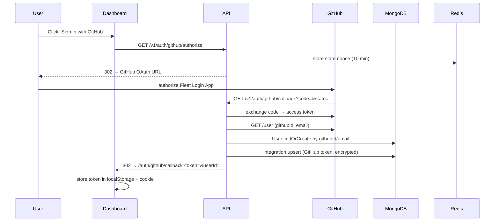
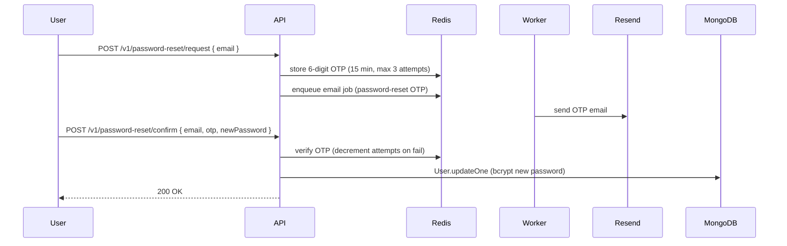
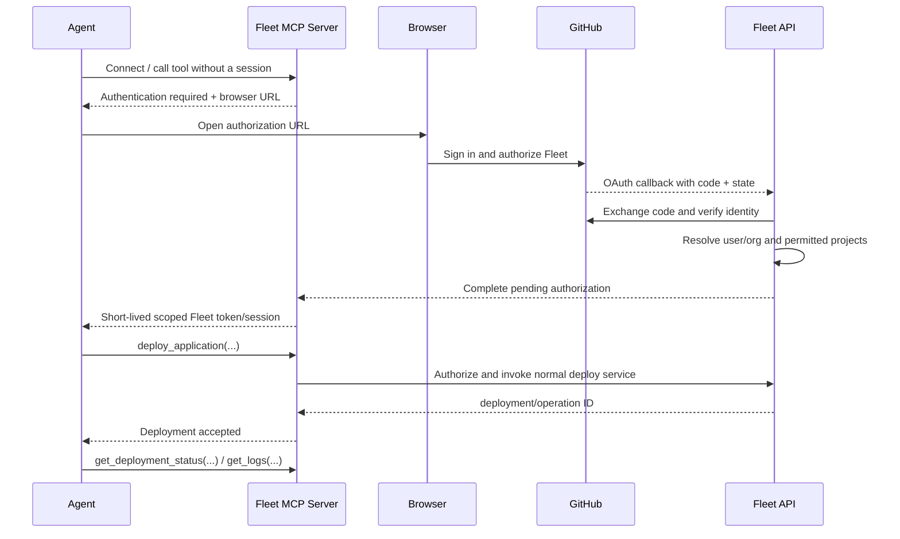
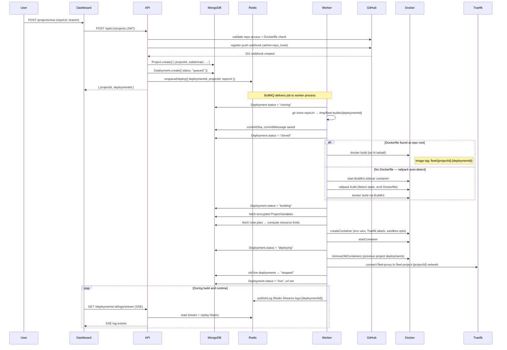
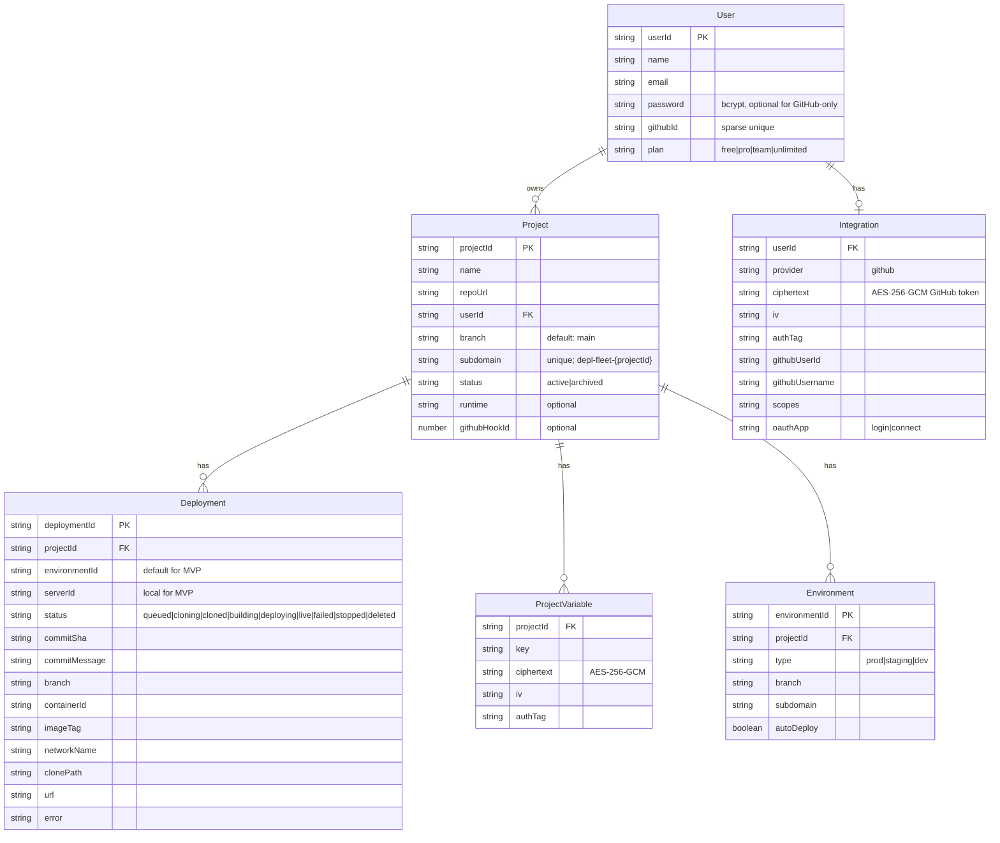

# Fleet — Self-Hosted PaaS: System Architecture

Fleet is a **self-hosted Platform-as-a-Service** built as a Bun monorepo. Users connect a Git repository, trigger a deployment, and Fleet clones the code, builds a Docker image, runs a sandboxed container behind Traefik, and serves it on a stable subdomain URL.

---

## Table of Contents

1. [Architecture Overview](#architecture-overview)
2. [Services and Components](#services-and-components)
3. [Authentication Flows](#authentication-flows)
4. [Agent MCP Access (Proposed)](#agent-mcp-access-proposed)
5. [Deploy Pipeline](#deploy-pipeline)
6. [Data Model](#data-model)
7. [API Endpoints](#api-endpoints)
8. [Infrastructure](#infrastructure)
9. [Security Model](#security-model)
10. [Plan Tiers](#plan-tiers)
11. [Environment Variables](#environment-variables)
12. [Local Development Ports](#local-development-ports)
13. [Roadmap / Not Yet Implemented](#roadmap--not-yet-implemented)

---

## Architecture Overview

```mermaid
graph TD
    Browser[Browser / User]
    GitHub[GitHub\nOAuth Login · OAuth Connect\nPush Webhooks · Repos API]
    Resend[Resend\nEmail API]

    subgraph AppLayer [Application Layer]
        Dashboard[Next.js Dashboard\n:3000]
        API[Express API\n:3010]
    end

    subgraph DataLayer [Data Layer]
        MongoDB[(MongoDB\nUsers · Projects · Deployments\nVariables · Integrations)]
        Redis[(Redis :16379\nBullMQ Queues · Log Streams\nOAuth State · OTP Cache)]
    end

    subgraph WorkerLayer [Worker / Processing]
        subgraph DeployPipeline [Deploy Worker — BullMQ deploy queue]
            Clone[1. Clone\nsimple-git]
            Detect[2. Detect Runtime\nDockerfile vs railpack]
            Build[3. Build Image\ndocker build or railpack+BuildKit]
            RunStep[4. Run Container\nsandbox + Traefik labels]
        end
        EmailWorker[Email Worker\nBullMQ email queue]
    end

    subgraph InfraLayer [Infrastructure]
        DockerEngine[Docker Engine\ndockerode]
        Traefik[Traefik v3\nReverse Proxy :18080]
        DeployedApps[Deployed App Containers\ndepl-fleet-{projectId}.{domain}]
    end

    Browser -->|HTTPS| Dashboard
    Dashboard <-->|REST + JWT Bearer / SSE logs| API
    GitHub <-->|OAuth callbacks + Webhooks HMAC| API
    API -->|read / write| MongoDB
    API -->|enqueue jobs · cache · publish logs| Redis
    Redis -->|consume deploy job| Clone
    Redis -->|consume email job| EmailWorker
    Clone --> Detect
    Detect --> Build
    Build --> RunStep
    RunStep -->|docker build + docker run| DockerEngine
    RunStep -->|publish logs| Redis
    EmailWorker -->|Resend HTTP API| Resend
    DockerEngine <-->|network attach| Traefik
    Traefik -->|subdomain routing| DeployedApps
    Browser -.->|app traffic| DeployedApps
```

---

## Services and Components

### Next.js Dashboard — Port 3000

The user-facing SPA. All API calls go through a Next.js route handler that proxies to the API server (rewrites `/api-proxy/*` → `http://127.0.0.1:3010`).

| Area | Routes |
|------|--------|
| Auth | `/login`, `/signup`, `/forgot-password`, `/reset-password`, `/auth/github/callback` |
| Projects | `/projects`, `/projects/new` (GitHub repo picker), `/projects/[id]` |
| Deployments | `/deployments/[id]` (log stream via SSE) |
| Connections | `/connections` (GitHub OAuth connect) |
| Settings | `/settings` (profile, plan info) |

**Stack:** Next.js 16, React 19, Tailwind 4, shadcn/ui, SWR, Zustand, Framer Motion.

**Auth storage:** JWT in `localStorage` + `fleet_token` cookie (for server-side access).

---

### Express API — Port 3010

The backend HTTP server. All routes under `/api/v1` require `Authorization: Bearer <JWT>`. The API:
- Persists data to MongoDB
- Enqueues BullMQ jobs to Redis
- Publishes deployment status/log events via Redis Streams
- Streams logs to Dashboard via Server-Sent Events (SSE)

---

### BullMQ Worker

A separate Bun process consuming two queues:

| Queue | Job | Handler |
|-------|-----|---------|
| `deploy` | `{ deploymentId, projectId, repoUrl }` | Full clone→build→run pipeline |
| `email` | `{ type, ...payload }` | Resend API call; 3 retries, exponential backoff |

Job ID = `deploymentId` for deduplication. In-flight jobs check `stopped`/`deleted` status between pipeline steps and abort early if the deployment was cancelled.

---

### MongoDB

Primary database via Mongoose. No migrations — schema-per-model.

**Collections:** `User`, `Project`, `Deployment`, `ProjectVariable`, `Integration`, `Environment` (scaffold), `Server` (scaffold).

---

### Redis — Port 16379 (via docker-compose)

Used for three distinct purposes:

| Purpose | Mechanism | TTL |
|---------|-----------|-----|
| BullMQ job queues | BullMQ data structures | Per job |
| Deployment log streams | Redis Streams (`logs:{deploymentId}`) | 24 h |
| OAuth state nonces | String keys (`github:oauth:state:*`) | 10 min |
| Password-reset OTP | String keys (`password-reset:*`) | 15 min |

---

### Docker Engine

Accessed via `dockerode` (Node Docker client on the local socket).

- **Build:** tarballs the cloned directory and calls `docker build` with streaming output. If no Dockerfile is found, falls back to Railpack + a BuildKit sidecar container.
- **Run:** Creates and starts a container with sandbox host config, env vars (decrypted from MongoDB), and Traefik routing labels.
- **Networks:** Each project gets a dedicated Docker bridge network (`fleet-project-{projectId}`). Traefik is connected to each project network as needed.

---

### Traefik v3

Runs via docker-compose. Mounts the Docker socket to discover containers dynamically via label-based configuration.

| Port | Purpose |
|------|---------|
| 18080 | HTTP entrypoint for all deployed apps |
| 18081 | Traefik dashboard UI |

Routing rule per deployment: ``Host(`{subdomain}.{FLEET_APPS_DOMAIN}`)``

---

### GitHub Integration

Fleet uses **two separate GitHub OAuth Apps**:

| App | Purpose | Scopes |
|-----|---------|--------|
| Login app | Sign in / sign up via GitHub | `read:user`, `user:email` |
| Connect app | Access repos, register webhooks | `read:user`, `repo`, `admin:repo_hook` |

GitHub tokens are stored AES-256-GCM encrypted in the `Integration` collection. Webhooks use `X-Hub-Signature-256` HMAC verification.

---

### Resend

Transactional email via the Resend HTTP API. Three template types:

| Template | Trigger |
|----------|---------|
| Signup welcome | Account creation |
| Login notification | Each email/password login |
| Password-reset OTP | Forgot-password flow (6-digit code, 15-min TTL) |

---

## Authentication Flows

### Email / Password



### GitHub OAuth Login



### Password Reset



---

## Agent MCP Access (Proposed)

Fleet can expose a remote MCP server as an agent-friendly control plane over
the same application services used by the dashboard and REST API. This would
allow an MCP-capable agent to deploy and operate applications without teaching
it Fleet's internal HTTP API.

When an agent connects without a valid Fleet MCP session, the server returns an
authentication challenge and browser URL. The user signs in with GitHub in the
browser, GitHub redirects to Fleet's backend, and Fleet completes the pending
MCP authorization. GitHub's access token remains encrypted on the server;
Fleet instead issues the MCP client its own short-lived, scoped, revocable
token.



The MCP adapter should remain thin: every mutation must use the normal Fleet
API, queue, sandbox, and deployment lifecycle rather than creating a separate
agent-only execution path. Long-running operations return an operation or
deployment ID so agents can poll status or stream logs.

Initial tools may include:

| Tool | Purpose | Suggested default scope |
|------|---------|-------------------------|
| `list_projects` | List projects visible to the authenticated user | Read |
| `get_deployment_status` | Inspect deployment state and URL | Read |
| `get_logs` | Read build and runtime logs | Read |
| `deploy_application` | Create a project/deployment or redeploy a project | Deploy |
| `restart_service` | Restart a running service through the normal deployment path | Operate |
| `stop_service` | Stop a deployment | Destructive |
| `rollback_deployment` | Promote a known previous release when rollback exists | Destructive |

An authenticated agent can therefore select a permitted project, trigger a
deployment, monitor its progress, inspect a failure, and operate the resulting
service entirely through MCP. It can only perform actions exposed by Fleet's
tool schemas and allowed by the token's scopes; MCP access does not grant
arbitrary backend or host access.

MCP tokens must be hashed at rest, short-lived, scoped, revocable, optionally
restricted to specific projects/environments, and excluded from tool output and
logs. Default access should be read-only. Production deploys, secret changes,
rollbacks, stops, and deletions should support explicit approval policies. Each
tool call must produce an audit event containing the user, agent session,
project, arguments (with secrets redacted), result, and correlation ID.

---

## Deploy Pipeline

### Trigger Sources

A deployment can be triggered by:
1. **Project creation** — `POST /api/v1/projects` auto-enqueues on create
2. **Manual redeploy** — `POST /api/v1/projects/:id/deploy`
3. **GitHub webhook** — push to tracked branch calls `triggerDeployForProject()`
4. **Env var save** — `PUT /api/v1/projects/:id/variables` auto-redeploys unless `?redeploy=false`

### Full Pipeline Sequence



### Deployment Status Lifecycle

```
queued → cloning → cloned → building → deploying → live
                                     ↘ failed
                                                  ↘ stopped (replaced by new deploy)
                                                  ↘ deleted (manual cancel)
```

---

## Data Model



---

## API Endpoints

### Public — No Auth

| Method | Path | Description |
|--------|------|-------------|
| GET | `/health` | Health check |
| GET | `/ping` | Pong |
| POST | `/v1/signup` | Create account → JWT |
| POST | `/v1/login` | Email/password login → JWT |
| POST | `/v1/password-reset/request` | Send 6-digit OTP |
| POST | `/v1/password-reset/confirm` | Verify OTP + set new password |
| GET | `/v1/auth/github/authorize` | GitHub login OAuth redirect |
| GET | `/v1/auth/github/callback` | GitHub login OAuth callback |
| GET | `/api/v1/integrations/github/callback` | GitHub connect OAuth callback |
| POST | `/webhooks/github` | Push webhook (HMAC verified, raw body) |

### Authenticated — `Authorization: Bearer <JWT>`

**Users** (`/api/v1/users`)

| Method | Path | Description |
|--------|------|-------------|
| GET | `/users` | Get current user (includes `plan`) |
| PATCH | `/users` | Update name and/or password |

**Projects** (`/api/v1/projects`)

| Method | Path | Description |
|--------|------|-------------|
| POST | `/projects` | Create project + auto-start deploy |
| GET | `/projects` | List user's projects with latest deployment |
| POST | `/projects/:id/deploy` | Manual redeploy |
| DELETE | `/projects/:id` | Archive project + stop containers + remove webhook |
| GET | `/projects/:id/variables` | List env var keys (values masked) |
| PUT | `/projects/:id/variables` | Update env vars; auto-redeploys unless `?redeploy=false` |

**Deployments** (`/api/v1/deployments`)

| Method | Path | Description |
|--------|------|-------------|
| GET | `/deployments/project/:projectId` | List deployments for a project |
| GET | `/deployments/:id` | Full deployment record |
| GET | `/deployments/:id/status` | Status, url, error only |
| GET | `/deployments/:id/logs/stream` | SSE: build logs then runtime docker logs |
| DELETE | `/deployments/:id` | Cancel / stop deployment |

**GitHub Integration** (`/api/v1/integrations`)

| Method | Path | Description |
|--------|------|-------------|
| GET | `/integrations/github/connect` | Redirect to GitHub OAuth (connect scope) |
| GET | `/integrations/github/status` | Connection status + `needsReconnect` flag |
| DELETE | `/integrations/github` | Disconnect + revoke token |
| GET | `/integrations/github/repos` | List repos (paginated, searchable) |
| GET | `/integrations/github/repos/:owner/:repo` | Repo metadata |
| GET | `/integrations/github/repos/:owner/:repo/branches` | List branches |
| POST | `/integrations/github/repos/validate` | Validate access + Dockerfile/railpack detection |

---

## Infrastructure

### docker-compose Services

```
services:
  redis:
    image: redis:7
    ports: ["16379:6379"]

  traefik:
    image: traefik:v3.6
    ports:
      - "18080:80"   # app HTTP traffic
      - "18081:8080" # Traefik dashboard
    volumes:
      - /var/run/docker.sock:/var/run/docker.sock:ro
    networks: [fleet-proxy]
    command:
      - --providers.docker=true
      - --providers.docker.exposedbydefault=false
      - --entrypoints.web.address=:80
```

### Docker Network Topology

```
Docker Host
├── fleet-proxy network
│   └── traefik container
│
├── fleet-project-{projectId-A} network
│   ├── traefik (dynamically connected)
│   └── fleet-project-{projectIdA}-{deploymentId} (running app)
│
└── fleet-project-{projectId-B} network
    ├── traefik (dynamically connected)
    └── fleet-project-{projectIdB}-{deploymentId} (running app)
```

Containers are isolated: they can only communicate within their project network. Cross-project access is not possible.

### Container Labels (Traefik Routing)

```
fleet.managed = true
fleet.project.id = {projectId}
fleet.deployment.id = {deploymentId}
traefik.enable = true
traefik.http.routers.{projectId}.rule = Host(`{subdomain}.{domain}`)
traefik.http.routers.{projectId}.entrypoints = web
traefik.http.services.{projectId}.loadbalancer.server.port = {containerPort}
```

### Blue-Green Deployment Flow

```
1. Build new image  →  fleet/{projectId}:{newDeploymentId}
2. Create + start new container  (not yet routed by Traefik)
3. Remove all old project containers
4. Connect Traefik container to fleet-project-{projectId} network
5. Mark previous "live" deployments → "stopped"
6. New deployment → "live" + stable url set
```

The URL is stable across deployments: it is derived from `projectId`, not `deploymentId`.

---

## Security Model

### JWT Authentication

- Library: `jose` (sign / verify)
- Algorithm: HS256, secret from `JWT_SECRET` (≥32 chars)
- Expiry: 7 days
- Transport: `Authorization: Bearer <token>` header

### Secret Encryption

All sensitive values at rest are encrypted with AES-256-GCM:
- **GitHub OAuth tokens** — stored in `Integration` collection
- **Project env vars** — stored in `ProjectVariable` collection
- Key material: `FLEET_SECRETS_ENCRYPTION_KEY` (base64-encoded 32 bytes)
- Each value has its own random IV (12 bytes) and auth tag (16 bytes)

### Webhook HMAC

GitHub push webhooks are verified with `GITHUB_WEBHOOK_SECRET` using `X-Hub-Signature-256` (HMAC-SHA256 over raw body).

### Container Sandbox

Every container (except `unlimited` plan) runs with:

```json
{
  "CapDrop": ["ALL"],
  "SecurityOpt": ["no-new-privileges:true"],
  "Memory": <plan limit>,
  "NanoCpus": <plan limit>,
  "PidsLimit": <plan limit>,
  "Tmpfs": { "/tmp": "size=<plan limit>" }
}
```

---

## Plan Tiers

| Plan | RAM | CPU | PIDs | /tmp | Status |
|------|-----|-----|------|------|--------|
| `free` | 256 MB | 0.25 core | 128 | 32 MB | Default |
| `pro` | 1024 MB | 1 core | 256 | 64 MB | Coming soon |
| `team` | 4096 MB | 4 cores | 512 | 128 MB | Coming soon |
| `unlimited` | — | — | — | — | No resource caps |

Limits are applied at container creation time in the worker (`getComputeLimitsForUser()`). Overridable per deployment via `FLEET_PLAN_LIMITS_JSON` env var.

---

## Environment Variables

All variables are loaded from a single root `.env` file.

### Shared (API + Worker)

| Variable | Default | Required |
|----------|---------|----------|
| `MONGODB_URI` | — | Yes |
| `REDIS_URL` | `redis://localhost:16379` | Yes |
| `FLEET_APPS_DOMAIN` | `localhost` | Yes |
| `FLEET_PUBLIC_URL_SCHEME` | `http` | No |
| `FLEET_TRAEFIK_PUBLIC_PORT` | — | No |
| `FLEET_TRAEFIK_NETWORK` | `fleet-proxy` | No |
| `FLEET_TRAEFIK_CONTAINER` | `fleet-traefik` | No |
| `FLEET_SECRETS_ENCRYPTION_KEY` | — | Yes (base64 32-byte) |
| `FLEET_PLAN_LIMITS_JSON` | — | No |
| `RESEND_API_KEY` | — | Yes |
| `RESEND_FROM_EMAIL` | `Fleet <onboarding@resend.dev>` | No |
| `DASHBOARD_URL` | `http://localhost:3000` | No |
| `NODE_ENV` | `development` | No |

### API-only

| Variable | Purpose |
|----------|---------|
| `JWT_SECRET` | Min 32 chars, for HS256 signing |
| `PORT` | API port (default 3010) |
| `API_URL` | Public API URL for webhook registration |
| `GITHUB_WEBHOOK_SECRET` | HMAC key for push webhooks |
| `GITHUB_CLIENT_ID/SECRET/CALLBACK_URL` | OAuth Connect App |
| `GITHUB_LOGIN_CLIENT_ID/SECRET/CALLBACK_URL` | OAuth Login App |

### Dashboard

| Variable | Purpose |
|----------|---------|
| `API_INTERNAL_URL` | Server-side proxy target (default `http://127.0.0.1:3010`) |
| `NEXT_PUBLIC_API_URL` | Client-side API base (defaults to `/api-proxy`) |
| `NEXT_PUBLIC_GA_MEASUREMENT_ID` | Google Analytics (optional) |

---

## Local Development Ports

| Service | Port |
|---------|------|
| Dashboard (Next.js) | 3000 |
| API (Express) | 3010 |
| Redis | 16379 |
| Traefik (apps) | 18080 |
| Traefik dashboard | 18081 |
| Deployed app example | `http://depl-fleet-{projectId}.localhost:18080` |

---

## Roadmap / Not Yet Implemented

| Item | Status |
|------|--------|
| **Agent** (`apps/agent`) | Message types defined, no implementation |
| **Remote MCP interface** | Proposed browser/GitHub authentication and scoped agent tools; not implemented |
| **CLI** (`apps/cli`) | Dependencies added, no implementation |
| **Remote server** (`Server` model) | Schema ready; MVP uses `serverId: "local"` |
| **Multi-environment** (`Environment` model) | Schema ready; MVP uses `environmentId: "default"` |
| **Deployment rollback** | `rollback` status defined, flow not implemented |
| **Registry push** (GHCR) | Images are local Docker tags only |
| **Dockerfile in subdirectory** | Only repo root Dockerfile supported |
| **Stripe / billing** | UI shows "Coming soon" for Pro/Team upgrade |
| **Teams / multi-user projects** | Not implemented |
| **Slack/email alerts on failure** | Planned |
| **Project-level queue priority** | Planned (plans differ only in compute today) |
